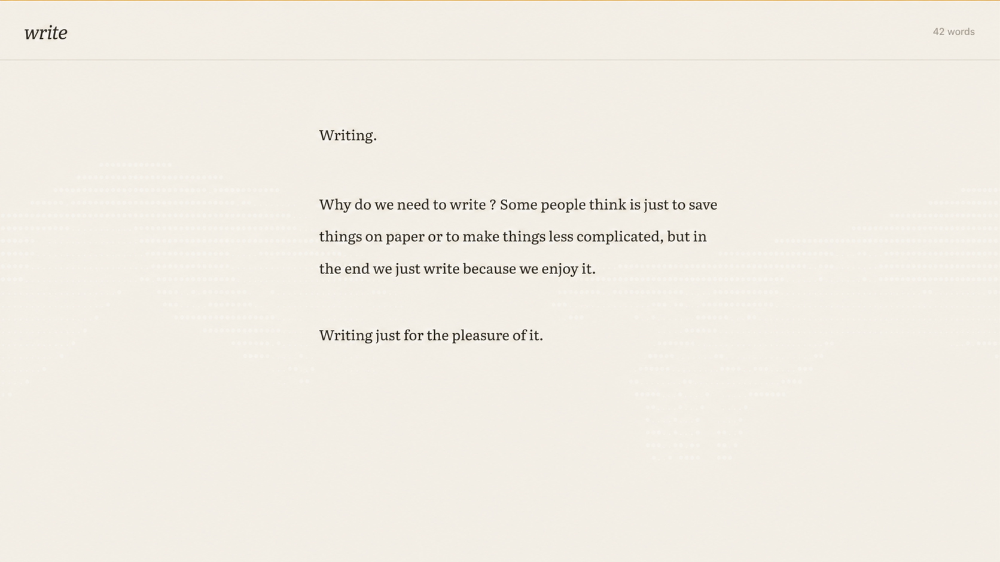
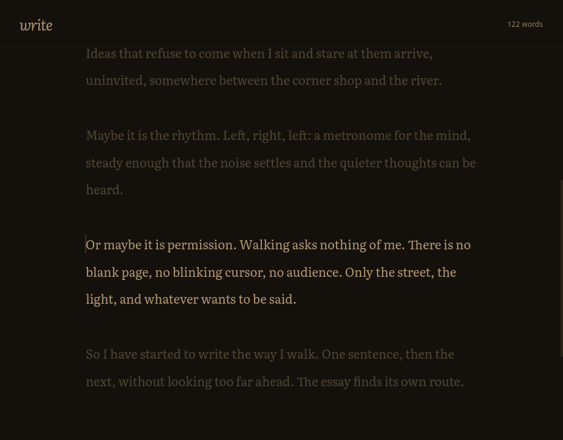
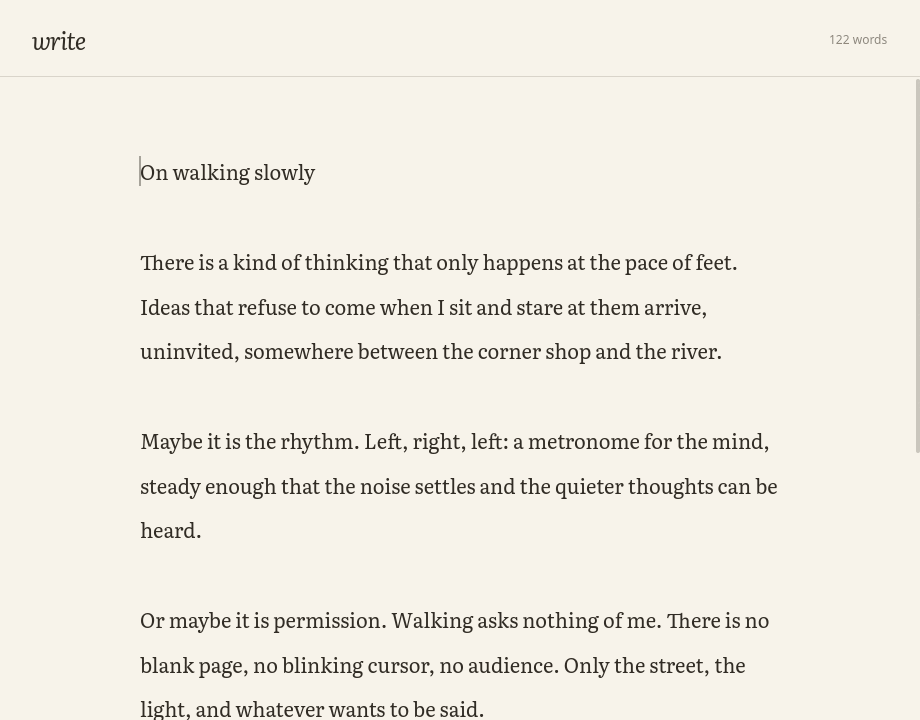
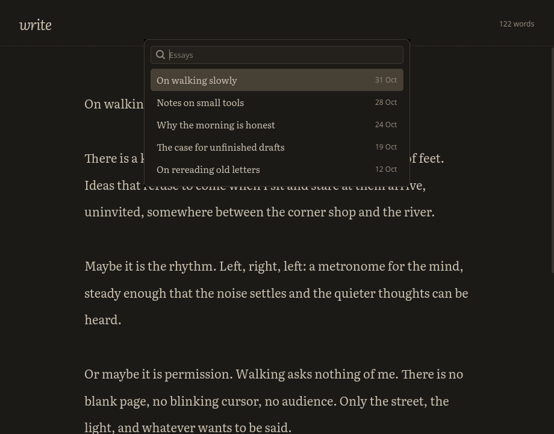
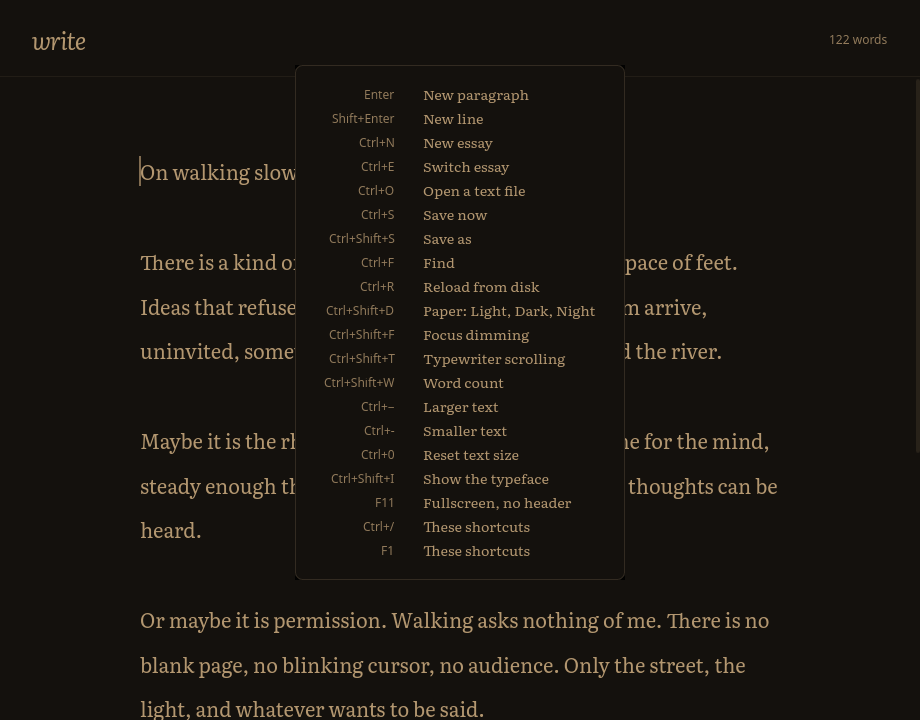

# Write

> A tiny, native Linux app for the joy of writing.



Write opens to one quiet page, so you can put your ideas on paper and see
where they go. There are no goals, streaks, or counters to keep up with.
It saves plain text by itself and keeps every control behind a shortcut.



## Features

- **Three papers.** Light, a soft warm Dark, and a dim amber Night for late
  writing. `Ctrl+Shift+D` cycles them. Dark and Night keep contrast gentle
  (about 9.6:1 and 6.8:1) to cut glare, and the soft amber caret, selection,
  and scrollbar follow the paper. On first launch Write starts on Dark if your
  desktop prefers dark.
- **Essays as separate files.** Each essay is its own plain `.txt` file in
  `~/Documents/Essays`, named from the date and its first line. `Ctrl+N`
  starts a new one, `Ctrl+E` lets you search and switch, and Write reopens the
  one you were on.
- **Autosave and backups.** Every change is saved quietly and crash-safely
  (written to a temporary file, then swapped in). Timestamped backups are taken
  when a file opens and then at most every five minutes; the newest 20 per file
  are kept. A clear “Not saved” warning appears if saving ever fails, and Write
  notices when another program changes the file.
- **Focus dimming.** `Ctrl+Shift+F` quiets every paragraph but the one you are
  writing.
- **Typewriter scrolling.** The line you are writing stays in the middle of the
  page (on by default, `Ctrl+Shift+T`).
- **Quiet chrome.** While you type, the header and pointer fade away; move the
  mouse to bring them back. `F11` goes fullscreen with no header at all.
- **Find and text size.** `Ctrl+F` finds text; `Ctrl+=`, `Ctrl+-`, and
  `Ctrl+0` change the size of the type, set in Literata.
- **Shortcuts at hand.** `Ctrl+/` or `F1` shows every shortcut on a sheet that
  matches the paper.

Your paper, text size, word count, focus dimming, typewriter scrolling, and the
cursor position in each document are remembered.

There are no accounts, cloud services, databases, web views, formatting
toolbars, or telemetry. The executable is well under 100 KB; GTK remains a
normal system dependency and is never bundled into a huge package.

| Light paper | Switching essays (`Ctrl+E`) | Shortcuts (`Ctrl+/`) |
| --- | --- | --- |
|  |  |  |

## Install

Write uses C++20 and GTK4 (version 4.10 or newer).

On Arch Linux:

```sh
sudo pacman -S --needed base-devel gtk4
make
sudo make install
```

On another Linux distribution, install a C++ compiler, GNU Make, `pkg-config`,
and the GTK4 development package, then run the same last two commands.

To install just for yourself, without `sudo`, into `~/.local`:

```sh
make PREFIX=$HOME/.local
make PREFIX=$HOME/.local install
```

Use the same `PREFIX` for both commands, because the font location is built
in. Make sure `~/.local/bin` is on your `PATH`.

Launch it from your app menu, or with:

```sh
write
write notes/today.txt
```

A file argument opens that file, in the running window if Write is already open.
A missing file is created on the first save.

To run it from the source tree without installing it, use `make run`. Run the
tests with `make test`.

## Keyboard shortcuts

Press `Ctrl+/` or `F1` in Write to see these on the page; `Esc` or the same key
closes the sheet.

| Keys | Action |
| --- | --- |
| `Enter` | New paragraph (with breathing room) |
| `Shift+Enter` | New line |
| `Ctrl+N` | New essay (the current one is saved first) |
| `Ctrl+E` | Switch essay: type to filter, `↑`/`↓` to choose, `Enter` opens, `Esc` closes |
| `Ctrl+O` | Open a text file |
| `Ctrl+S` | Save immediately |
| `Ctrl+Shift+S` | Choose where to save |
| `Ctrl+F` | Find text: `Enter` finds next, `Shift+Enter` finds previous, `Esc` closes |
| `Ctrl+R` | Reload the file from disk after another program changed it (your text is backed up first) |
| `Ctrl+Shift+D` | Switch paper: Light → Dark → Night |
| `Ctrl+Shift+F` | Focus dimming: dim all but the current paragraph |
| `Ctrl+Shift+T` | Typewriter scrolling on or off (on by default) |
| `Ctrl+Shift+W` | Show or hide the word count |
| `Ctrl+=` | Larger text (`Ctrl++` works too) |
| `Ctrl+-` | Smaller text |
| `Ctrl+0` | Reset text size |
| `Ctrl+Shift+I` | Show the active writing typeface |
| `F11` | Focus mode: fullscreen, no header |
| `Ctrl+/` | Show or hide these shortcuts |
| `F1` | Show or hide these shortcuts |

## Data and portability

Your writing is ordinary text and remains portable independently of the app.
Until you use Save As, the default document is stored at
`~/.local/share/write/document.txt`; its cursor-position metadata lives only in
the matching app-data folder. Backups live in `~/.local/share/write/backups/`, one folder per document.
Preferences (paper, text size, word count, focus dimming, typewriter scrolling,
the essays folder, and the last
document you had open) live in `~/.config/write/settings.ini`; delete it to
return to the defaults.

Essays live in `~/Documents/Essays` (or `~/Essays` without a Documents folder);
change `essays-folder` in `settings.ini` to keep them elsewhere. A new essay
becomes a file only once it has text. Until its first line is finished it is
named by date and time, such as `2026-10-31 2214.txt`; when you press `Enter`
after that line it is renamed once, to `2026-10-31 on solitude.txt`. After that
the name stays put, so rename the file by hand if the title changes.
Copy the `.txt` file anywhere; it needs no Write
database to remain yours.

Write saves UTF-8. A file in another encoding (such as Latin-1, Windows-1252,
or UTF-16 with a byte-order mark) still opens readably: Write converts it,
says which encoding it read, and keeps the original bytes in the backups. The
file is written as UTF-8 once you edit it.

## License

MIT. See [LICENSE](LICENSE).

Literata is bundled under the SIL Open Font License 1.1; see
[assets/OFL.txt](assets/OFL.txt).
